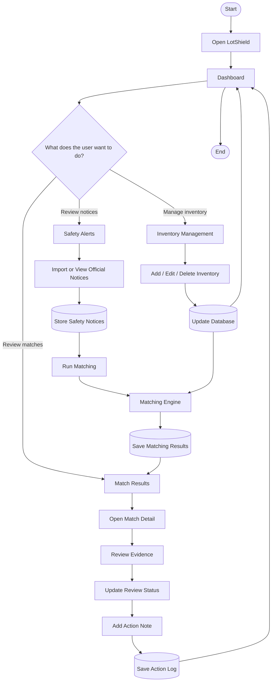
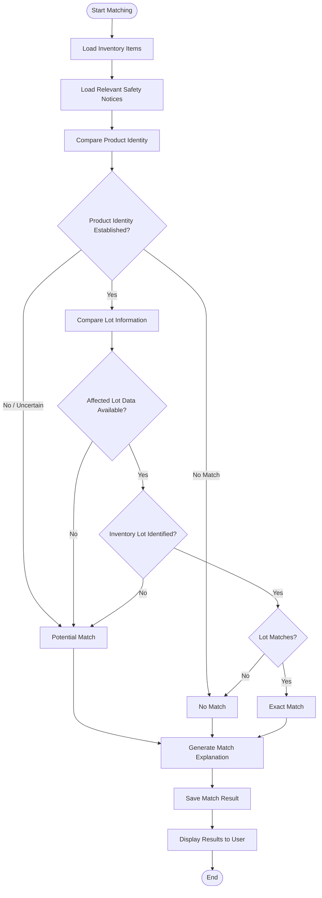
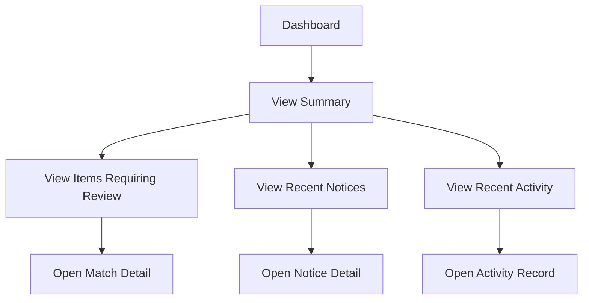
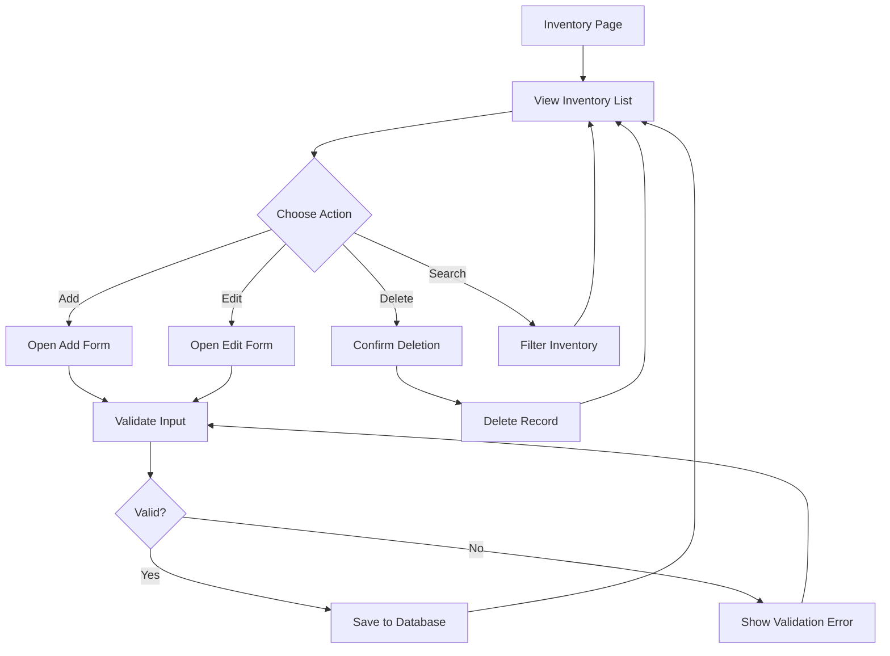
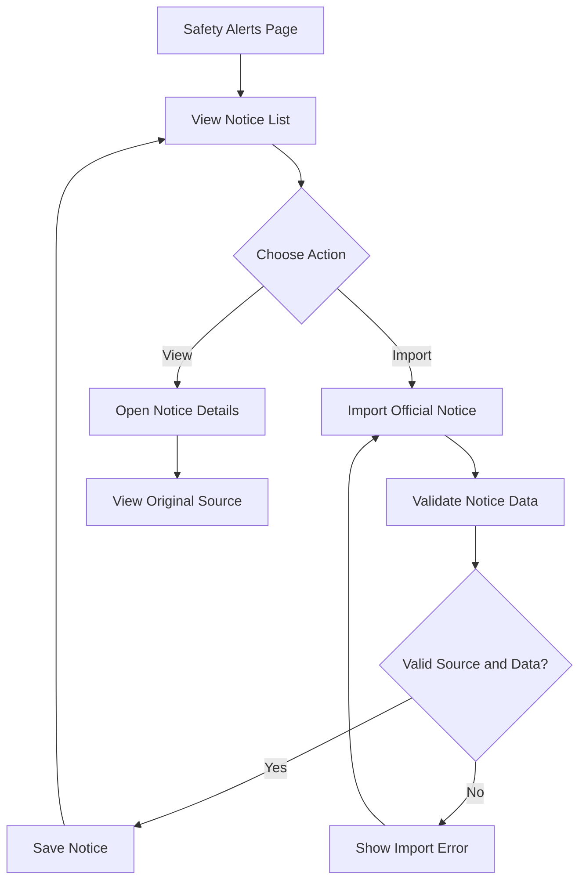
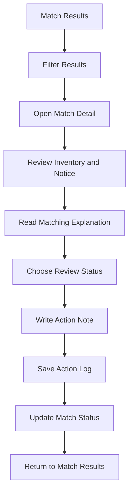
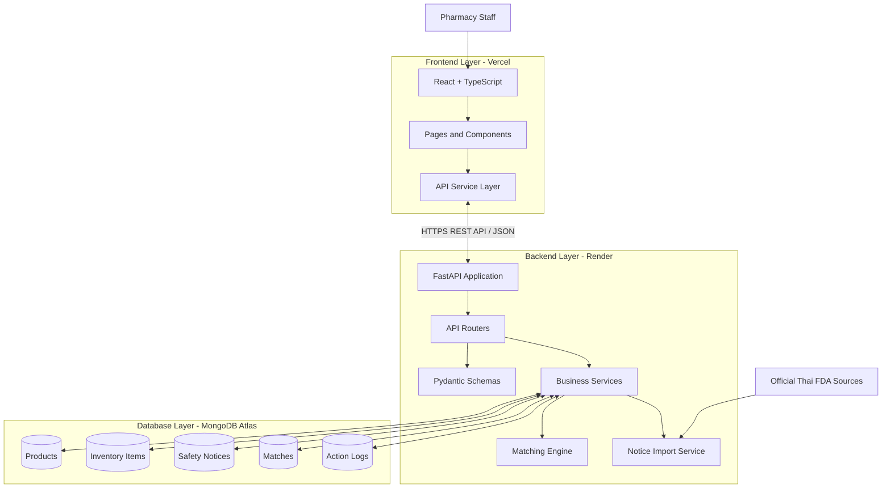
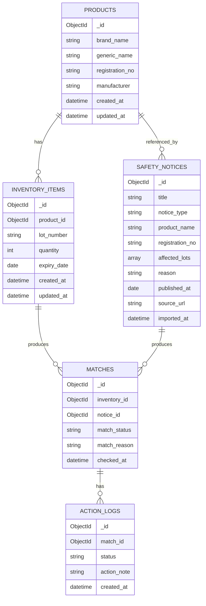

# LotShield
## Medicine Recall & Safety Monitoring System for Independent Pharmacies

> **Project Blueprint | Technical Specification | Database Design | User Flow | Development Roadmap**

**Project Name:** LotShield  
**Project Type:** Full-stack Web Application  
**Target Users:** Independent Pharmacies / Pharmacy Staff  
**Primary Goal:** Help independent pharmacies identify potentially affected medicines in their inventory by comparing inventory records against official medicine safety alerts and recall notices.

**Status:** Planning & MVP Development  
**Version:** 1.0.0

---

# 1. Project Overview

## 1.1 What is LotShield?

LotShield is a web-based medicine recall and safety monitoring system designed for independent pharmacies.

The system helps pharmacy staff monitor official medicine safety announcements and identify whether products currently stored in their inventory may be affected by those announcements.

Pharmacies can maintain their medicine inventory, review official safety notices, and run a matching process that compares product registration numbers, product identities, and batch/lot numbers.

When a potential match is detected, LotShield displays the relevant information and provides an evidence-based explanation so that pharmacy staff can review the result and record their actions.

The system aims to make safety notice monitoring more organized, traceable, and manageable, particularly for smaller pharmacies that may not have dedicated inventory monitoring systems.

## 1.2 Problem Statement

Medicine safety alerts and recall announcements may contain important information about specific products or affected manufacturing batches.

However, independent pharmacies may face several practical challenges:

- Safety announcements may be published across official information channels.
- Pharmacy staff may need to manually check whether an announced product exists in their inventory.
- Product names may differ between inventory records and official announcements.
- A recall may affect only specific manufacturing batches rather than every unit of a product.
- Staff need a way to record whether a potentially affected item has been reviewed and what action was taken.
- Previous checks may be difficult to track if the process relies on manual notes or spreadsheets.

The problem is not simply the lack of access to safety announcements. It is the difficulty of connecting those announcements to the actual products and batches a pharmacy currently holds.

## 1.3 Proposed Solution

LotShield provides a centralized workflow with five core capabilities:

1. **Inventory Management** — Maintain a record of medicines and their batch information.
2. **Safety Notice Monitoring** — Store and review official medicine safety announcements.
3. **Automated Matching** — Compare safety notices against pharmacy inventory.
4. **Match Review** — Explain why an inventory item was identified as an exact or potential match.
5. **Action Tracking** — Record review status and follow-up actions.

The system does not independently decide whether a medicine is safe to dispense, nor does it replace official guidance or professional pharmacist judgment.

It is a decision-support and monitoring tool.

## 1.4 Project Objectives

- Build a working full-stack web application.
- Demonstrate frontend, backend, database, and API integration.
- Work with real-world official safety announcement data.
- Implement explainable product and batch matching logic.
- Maintain a traceable record of review and follow-up actions.
- Deploy the application so that it can be accessed through a public URL.
- Demonstrate software engineering practices including data modeling, API design, validation, testing, and deployment.

## 1.5 Target Users

**Primary user: Independent Pharmacy Staff**

Typical tasks:

- Add medicines currently held by the pharmacy.
- Record registration numbers, batch numbers, quantities, and expiry dates.
- Review newly published safety notices.
- Check whether an announcement affects existing inventory.
- Review potential matches.
- Record the status and outcome of an investigation.

**MVP user assumption:** One demo pharmacy with one primary user environment. Authentication and multi-branch support are outside the initial scope.

---

# 2. Product Scope

## 2.1 MVP Features

The MVP consists of five main modules.

| Module | Main Purpose | Priority |
|---|---|---|
| Dashboard | Show overall monitoring status | Must Have |
| Inventory Management | Manage pharmacy inventory | Must Have |
| Safety Alerts | Store and display official notices | Must Have |
| Matching Engine | Identify potentially affected inventory | Must Have |
| Review & Action Logs | Track investigation and follow-up | Must Have |

## 2.2 Feature Specifications

### Feature 1: Dashboard

The dashboard is the main overview page.

It should provide a quick understanding of the pharmacy's current monitoring situation.

**Required information:**

- Total inventory items.
- Total safety notices stored.
- Number of items requiring review.
- Number of exact matches.
- Number of potential matches.
- Most recent notice update timestamp.
- Recent review activity.

**Suggested UI components:**

- Summary statistic cards.
- Items requiring review section.
- Recent safety notices.
- Recent activity timeline.
- Quick navigation to Inventory and Alerts.

**Important behavior:**

Dashboard statistics must come from backend/database data rather than hardcoded frontend values.

### Feature 2: Inventory Management

This module allows pharmacy staff to manage medicines currently held in the pharmacy.

**Required capabilities:**

- View all inventory items.
- Add a new medicine.
- Edit an existing inventory item.
- Delete an inventory item.
- Search inventory.
- Filter inventory by product or batch information.

**Inventory information:**

- Brand name.
- Generic name.
- Product registration number.
- Lot/batch number.
- Quantity.
- Expiry date.
- Date added.
- Last updated.

**Important design decision:**

A product may have multiple batches.

For example:

Product A:
- Lot L25001 — 30 units
- Lot L25002 — 20 units
- Lot L25003 — 15 units

Each batch should be represented as a separate inventory record.

This makes it possible to identify an affected batch without incorrectly flagging every batch of the same product.

### Feature 3: Safety Alerts

This module stores and displays official medicine safety announcements.

**Required capabilities:**

- View available safety notices.
- Search notices by product name or registration number.
- View notice details.
- Display the original source URL.
- Display the publication date.
- Display affected lot numbers when provided.
- Display the reason for the announcement.
- Identify whether information is missing or incomplete.

**Safety notice information:**

- Notice title.
- Notice type.
- Product name.
- Generic name, if available.
- Registration number, if available.
- Affected lot numbers, if available.
- Manufacturer, if available.
- Reason for recall or warning.
- Publication date.
- Source organization.
- Original source URL.
- Date imported into LotShield.

**Data source requirements:**

Use official Thai FDA sources wherever possible.

Before implementing automated data collection, inspect actual official notice pages and documents to determine:

- Whether the pages are publicly accessible.
- Whether product names are consistently available.
- Whether registration numbers are provided.
- Whether lot/batch numbers are provided.
- Whether the data is available in HTML, PDF, or another structured format.
- Whether the format is consistent enough to support reliable extraction.

Do not assume that every official notice contains a lot number or that a comprehensive public API exists.

For the MVP, manual/admin-assisted import of real official notices is acceptable if automated extraction is not reliable.

Every imported notice must retain its original source URL and publication information.

Never create fictional safety notices and present them as real official announcements.

### Feature 4: Matching Engine

This is the core business logic of LotShield.

The matching engine compares inventory records with safety notice records to identify potentially affected medicine batches.

**Main matching inputs:**

- Product registration number.
- Product identity.
- Brand name.
- Generic name.
- Lot/batch number.

**Initial matching classifications:**

| Result | Meaning |
|---|---|
| EXACT_MATCH | Product identity and affected lot are sufficiently identified and match |
| POTENTIAL_MATCH | Product identity appears to match, but the available lot information is incomplete or insufficient |
| NO_MATCH | Sufficient identifying information is available and indicates that the inventory item does not match the notice |

**Matching rules:**

Rule 1 — Product identity must be established before comparing lot numbers.

Rule 2 — When registration numbers are available and reliable, use them as a strong product identity signal.

Rule 3 — If registration numbers are unavailable, use validated product identity information. Do not rely on a loose name similarity alone to declare an exact match.

Rule 4 — If both product identity and lot number match an explicitly affected lot, classify the result as EXACT_MATCH.

Rule 5 — If the product identity matches but the notice does not provide enough lot information, classify it as POTENTIAL_MATCH.

Rule 6 — If the notice identifies affected lots and the inventory lot is different, the result may be NO_MATCH, provided product identity and lot data are sufficiently reliable.

Rule 7 — If required information is missing or contradictory, do not automatically classify the item as safe. Use a cautious review outcome or mark it as requiring manual verification.

**Illustrative matching pseudocode:**

```python
def match_inventory_to_notice(inventory, notice):
    product_match = identify_product(inventory, notice)

    if product_match == "UNKNOWN":
        return "POTENTIAL_MATCH"

    if product_match == "NO_MATCH":
        return "NO_MATCH"

    if not notice.affected_lots:
        return "POTENTIAL_MATCH"

    if not inventory.lot_number:
        return "POTENTIAL_MATCH"

    if inventory.lot_number in notice.affected_lots:
        return "EXACT_MATCH"

    return "NO_MATCH"
```

This is illustrative logic, not the final implementation.

The actual implementation must handle:

- Missing fields.
- Different letter casing.
- Whitespace and formatting differences.
- Product identity conflicts.
- Duplicate records.
- Lot number normalization.
- Notices that describe a lot range rather than individual lot numbers, if supported by the source.
- Historical matching results when data changes.

**Match explanation:**

Every result must include a human-readable explanation.

Examples:

EXACT_MATCH:
"Registration number and lot number match the affected product and batch stated in the official notice."

POTENTIAL_MATCH:
"The product registration number matches, but the notice does not specify affected lot numbers. Manual verification is required."

NO_MATCH:
"The product registration number matches, but the inventory lot number is not included in the affected lots listed in the notice."

The explanation must reflect the actual data used by the algorithm. Do not generate generic explanations that do not correspond to the result.

**Important safety rule:**

NO_MATCH means only that no match was identified using the available notice and inventory data. It does NOT mean the medicine is guaranteed safe.

### Feature 5: Review & Action Tracking

This module allows pharmacy staff to investigate matching results and record follow-up actions.

**Required capabilities:**

- View all matching results.
- Filter by match classification.
- Open a match detail page.
- View the related inventory item.
- View the related official notice.
- Read the matching explanation.
- Update review status.
- Record a note or action.
- View previous review history.

**Suggested review statuses:**

| Status | Meaning |
|---|---|
| PENDING | Not yet reviewed |
| REVIEWED | Reviewed by pharmacy staff |
| ESCALATED | Requires further investigation or consultation |
| ACTION_RECORDED | A follow-up action has been documented |

**Example action records:**

- Checked official announcement.
- Verified batch information with supplier.
- Contacted manufacturer.
- Separated affected inventory pending verification.
- Referred the matter to the responsible pharmacist.

These are examples of records, not automated instructions from LotShield.

The system must not automatically instruct users to destroy, withdraw, or dispense medicines.

---

# 3. User Flow

## 3.1 Main User Journey

The intended user journey is:

1. User opens LotShield.
2. User views the Dashboard.
3. User adds or updates inventory.
4. User opens Safety Alerts.
5. User reviews or imports official notices.
6. User runs the matching process.
7. System compares notices with inventory.
8. System displays matching classifications.
9. User opens a result and reviews the evidence.
10. User records a review status and follow-up action.
11. Dashboard updates to reflect the latest monitoring status.

## 3.2 Main Application Flowchart



## 3.3 Match Review Flowchart



**Implementation note:** The matching process must distinguish a genuine product mismatch from missing or unreliable data. Missing information should not be treated as proof that a medicine is unaffected.

## 3.4 User Flow by Page

### Dashboard



### Inventory Management



### Safety Alerts



### Review & Action Tracking



---

# 4. System Architecture

## 4.1 Architecture Overview

LotShield uses a three-layer architecture:

1. Frontend — User interface and interaction.
2. Backend — Business logic, API endpoints, validation, and database access.
3. Database — Persistent storage for inventory, notices, matches, and action history.

The frontend and backend are deployed separately.

The backend communicates with MongoDB Atlas and acts as the only application layer permitted to access the database.

## 4.2 Architecture Diagram



## 4.3 Frontend Responsibilities

The frontend is responsible for:

- Displaying the user interface.
- Handling navigation.
- Collecting and validating basic user input.
- Sending HTTP requests to the backend.
- Displaying API responses.
- Showing loading, empty, and error states.
- Displaying matching results and their explanations.
- Allowing users to record review actions.

The frontend must not:

- Connect directly to MongoDB.
- Store database credentials.
- Implement the authoritative matching logic.
- Invent dashboard statistics or matching results.
- Assume that an API request succeeded before receiving a successful response.

## 4.4 Backend Responsibilities

The backend is responsible for:

- Exposing REST API endpoints.
- Validating incoming requests.
- Managing inventory records.
- Managing safety notice records.
- Executing matching logic.
- Persisting matching results.
- Managing review statuses and action logs.
- Handling data imports.
- Returning consistent API responses.
- Handling errors and invalid input.

## 4.5 Database Responsibilities

MongoDB Atlas stores:

- Product information.
- Inventory batch records.
- Official safety notices.
- Matching results.
- Review and action history.

All database access must happen through the backend.

## 4.6 External Data Source

The initial external information source is official Thai FDA medicine safety information.

The backend's import service is responsible for bringing verified notice information into LotShield.

The initial implementation may use manually curated/admin-assisted imports.

Automated scraping or scheduled synchronization is not a required MVP feature.

---

# 5. Technology Stack

## 5.1 Frontend

| Technology | Purpose |
|---|---|
| React | Component-based UI development |
| TypeScript | Static typing and safer data handling |
| Vite | Frontend development and build tool |
| Tailwind CSS | Styling and responsive layouts |
| React Router | Page navigation |
| Axios | HTTP requests to backend API |
| Lucide React | UI icons |

**Deployment:** Vercel

### Frontend Structure

```text
frontend/
├── public/
├── src/
│   ├── assets/
│   ├── components/
│   │   ├── layout/
│   │   ├── dashboard/
│   │   ├── inventory/
│   │   ├── alerts/
│   │   └── matches/
│   ├── pages/
│   │   ├── Dashboard.tsx
│   │   ├── Inventory.tsx
│   │   ├── Alerts.tsx
│   │   ├── Matches.tsx
│   │   └── MatchDetail.tsx
│   ├── services/
│   │   └── api.ts
│   ├── types/
│   │   ├── product.ts
│   │   ├── inventory.ts
│   │   ├── notice.ts
│   │   └── match.ts
│   ├── hooks/
│   ├── utils/
│   ├── App.tsx
│   └── main.tsx
├── .env.example
├── package.json
└── vite.config.ts
```

## 5.2 Backend

| Technology | Purpose |
|---|---|
| Python | Main backend language |
| FastAPI | REST API framework |
| Pydantic | Request and response validation |
| PyMongo | MongoDB database driver |
| Pytest | Automated backend testing |
| Uvicorn | ASGI application server |
| Python-dotenv | Local environment configuration |

**Deployment:** Render

Use PyMongo's supported asynchronous API consistently if choosing an asynchronous FastAPI implementation. Alternatively, use synchronous PyMongo with synchronous route handlers. Do not mix sync and async database access without a clear reason.

### Backend Structure

```text
backend/
├── app/
│   ├── main.py
│   ├── config.py
│   ├── database.py
│   ├── dependencies.py
│   │
│   ├── models/
│   │   ├── product.py
│   │   ├── inventory.py
│   │   ├── notice.py
│   │   ├── match.py
│   │   └── action_log.py
│   │
│   ├── schemas/
│   │   ├── product.py
│   │   ├── inventory.py
│   │   ├── notice.py
│   │   ├── match.py
│   │   └── action_log.py
│   │
│   ├── routers/
│   │   ├── health.py
│   │   ├── products.py
│   │   ├── inventory.py
│   │   ├── notices.py
│   │   ├── matches.py
│   │   └── action_logs.py
│   │
│   ├── services/
│   │   ├── matching.py
│   │   ├── notice_importer.py
│   │   ├── inventory_service.py
│   │   └── dashboard_service.py
│   │
│   └── utils/
│       ├── normalization.py
│       └── responses.py
│
├── tests/
│   ├── test_inventory.py
│   ├── test_notices.py
│   ├── test_matching.py
│   └── test_action_logs.py
│
├── requirements.txt
└── .env.example
```

## 5.3 Database

**Database:** MongoDB Atlas

**Driver:** PyMongo

**Database name:** `lotshield_db`

MongoDB is selected because its document-based structure allows flexible storage of notice information, where fields may vary depending on the original official announcement.

The database will use separate collections for the main entities.

## 5.4 Deployment

| Component | Platform |
|---|---|
| Frontend | Vercel |
| Backend | Render |
| Database | MongoDB Atlas |
| Source Control | GitHub |

## 5.5 Development Tools

| Tool | Purpose |
|---|---|
| VS Code | Code editor |
| Git | Version control |
| GitHub | Repository and collaboration |
| Postman or Bruno | API testing |
| FastAPI Swagger UI | Interactive API documentation |
| MongoDB Atlas | Cloud database management |
| MongoDB Compass | Visual database inspection |
| Browser DevTools | Frontend debugging |

## 5.6 Technologies Intentionally Excluded from MVP

Do not add the following unless there is a strong implementation reason:

- Docker
- Redis
- Microservices
- AI / LLM integrations
- OCR
- Barcode scanning
- Push notifications
- Automated email notifications
- Multi-branch management
- Scheduled background synchronization

The objective is to deliver one complete, functional workflow rather than a large number of incomplete features.

---

# 6. Database Design

## 6.1 Database Overview

Database name:

```text
lotshield_db
```

Collections:

1. `products`
2. `inventory_items`
3. `safety_notices`
4. `matches`
5. `action_logs`

The system uses MongoDB ObjectId references to connect related records.

A product may have multiple inventory batch records.

A safety notice may affect one or more products or lots.

A match links an inventory item with a safety notice.

An action log records an activity related to a match.

## 6.2 Entity Relationship Overview

Although MongoDB is a document database, the following relationship diagram describes the logical relationships between collections.



## 6.3 Collection 1: products

Stores the master information for medicine products.

**Example document:**

```json
{
  "_id": "ObjectId",
  "brand_name": "Medicine A",
  "generic_name": "Example Drug",
  "registration_no": "123456789",
  "manufacturer": "Example Manufacturer",
  "created_at": "2026-10-30T10:00:00Z",
  "updated_at": "2026-10-30T10:00:00Z"
}
```

**Field descriptions:**

| Field | Type | Description |
|---|---|---|
| _id | ObjectId | Unique product identifier |
| brand_name | String | Product brand name |
| generic_name | String | Generic medicine name |
| registration_no | String | Product registration number |
| manufacturer | String | Manufacturer name |
| created_at | Date | Creation timestamp |
| updated_at | Date | Last update timestamp |

**Validation:**

- Brand name should not be empty.
- Registration number should be stored as a string.
- Registration number should be normalized before matching.
- Do not assume every product has a registration number.

## 6.4 Collection 2: inventory_items

Stores individual inventory batches.

**Example document:**

```json
{
  "_id": "ObjectId",
  "product_id": "ObjectId",
  "lot_number": "L25001",
  "quantity": 30,
  "expiry_date": "2027-05-30",
  "created_at": "2026-10-30T10:00:00Z",
  "updated_at": "2026-10-30T10:00:00Z"
}
```

**Field descriptions:**

| Field | Type | Description |
|---|---|---|
| _id | ObjectId | Unique inventory record |
| product_id | ObjectId | Reference to products |
| lot_number | String | Manufacturing batch number |
| quantity | Integer | Quantity held by pharmacy |
| expiry_date | Date | Product expiry date |
| created_at | Date | Creation timestamp |
| updated_at | Date | Last update timestamp |

**Validation:**

- `product_id` must reference an existing product.
- Quantity must be a non-negative integer.
- Lot number should be stored as a string.
- Expiry date must be a valid date.
- A product may have multiple inventory records with different lot numbers.

## 6.5 Collection 3: safety_notices

Stores official medicine safety announcements.

**Example document:**

```json
{
  "_id": "ObjectId",
  "title": "Official Medicine Safety Notice",
  "notice_type": "RECALL",
  "product_name": "Medicine A",
  "generic_name": "Example Drug",
  "registration_no": "123456789",
  "manufacturer": "Example Manufacturer",
  "affected_lots": [
    "L25001"
  ],
  "reason": "Quality issue",
  "published_at": "2026-10-20",
  "source_name": "Thai FDA",
  "source_url": "https://official-source.example",
  "imported_at": "2026-10-30T10:00:00Z",
  "data_completeness": {
    "has_registration_no": true,
    "has_lot_information": true,
    "has_manufacturer": true
  }
}
```

**Field descriptions:**

| Field | Type | Description |
|---|---|---|
| _id | ObjectId | Unique notice identifier |
| title | String | Notice title |
| notice_type | String | RECALL or WARNING |
| product_name | String | Product name |
| generic_name | String | Generic name, if available |
| registration_no | String | Registration number, if available |
| manufacturer | String | Manufacturer, if available |
| affected_lots | Array[String] | Affected batch numbers |
| reason | String | Reason for notice |
| published_at | Date | Official publication date |
| source_name | String | Source organization |
| source_url | String | Original source URL |
| imported_at | Date | Import timestamp |
| data_completeness | Object | Availability of key identifying fields |

**Important design considerations:**

- `affected_lots` may be empty.
- Some fields may be unavailable in the original announcement.
- Preserve original source information.
- Do not fabricate missing fields.
- Consider storing the original notice title and a short source excerpt to support traceability.
- Duplicate notice imports should be detected using a stable source identifier or source URL where possible.

## 6.6 Collection 4: matches

Stores matching results generated by the matching engine.

**Example document:**

```json
{
  "_id": "ObjectId",
  "inventory_id": "ObjectId",
  "notice_id": "ObjectId",
  "match_status": "EXACT_MATCH",
  "match_reason": "Product registration number and affected lot number match.",
  "matched_fields": [
    "registration_no",
    "lot_number"
  ],
  "checked_at": "2026-10-30T10:30:00Z",
  "matching_version": "1.0"
}
```

**Field descriptions:**

| Field | Type | Description |
|---|---|---|
| _id | ObjectId | Unique match identifier |
| inventory_id | ObjectId | Reference to inventory item |
| notice_id | ObjectId | Reference to safety notice |
| match_status | String | EXACT_MATCH / POTENTIAL_MATCH / NO_MATCH |
| match_reason | String | Explanation of the matching result |
| matched_fields | Array[String] | Fields used during comparison |
| checked_at | Date | Matching execution timestamp |
| matching_version | String | Version of matching logic |

**Important considerations:**

- Avoid creating duplicate match records unnecessarily.
- A matching run should have a clear definition of whether it replaces or versions previous results.
- Historical results should not silently become misleading after source data changes.
- Store the matching logic version to support future debugging and reproducibility.

For the MVP, the implementation may update the current result for an inventory-notice pair rather than keeping every execution as a separate historical run. Document that decision in the backend.

## 6.7 Collection 5: action_logs

Stores review activities and follow-up notes.

**Example document:**

```json
{
  "_id": "ObjectId",
  "match_id": "ObjectId",
  "status": "REVIEWED",
  "action_note": "Verified the lot information against the original notice.",
  "created_at": "2026-10-30T11:00:00Z"
}
```

**Field descriptions:**

| Field | Type | Description |
|---|---|---|
| _id | ObjectId | Unique action log identifier |
| match_id | ObjectId | Related matching result |
| status | String | Review/action status |
| action_note | String | User-entered action note |
| created_at | Date | Activity timestamp |

**Important considerations:**

- Action logs should be append-only for the MVP.
- Updating a match status should not erase previous action notes.
- Each new review activity should create a new log record.
- The current review status can be derived from the latest log or stored on the match document with a consistent update strategy.

## 6.8 Database Indexes

Recommended indexes:

| Collection | Field | Index Type / Purpose |
|---|---|---|
| products | registration_no | Search and matching |
| products | brand_name | Search |
| inventory_items | product_id | Find batches by product |
| inventory_items | lot_number | Batch lookup |
| safety_notices | registration_no | Matching |
| safety_notices | published_at | Sort by publication date |
| safety_notices | source_url | Duplicate detection |
| matches | inventory_id | Find matches by inventory |
| matches | notice_id | Find matches by notice |
| matches | match_status | Filter results |
| action_logs | match_id | Retrieve activity history |

Do not add unique indexes until the data model and duplicate-handling rules are confirmed.

---

# 7. Backend API Design

## 7.1 API Conventions

Base URL:

```text
/api
```

Use REST conventions.

- GET — Retrieve information.
- POST — Create a resource or trigger a process.
- PUT/PATCH — Update a resource.
- DELETE — Delete a resource.

Use JSON request and response bodies.

All endpoints should return appropriate HTTP status codes and clear error messages.

## 7.2 Health Check

| Method | Endpoint | Purpose |
|---|---|---|
| GET | `/api/health` | Check backend availability |

Expected response:

```json
{
  "status": "ok",
  "service": "LotShield API"
}
```

## 7.3 Products

| Method | Endpoint | Purpose |
|---|---|---|
| GET | `/api/products` | List products |
| POST | `/api/products` | Create product |
| GET | `/api/products/{id}` | Get product detail |
| PUT | `/api/products/{id}` | Update product |
| DELETE | `/api/products/{id}` | Delete product if safe to do so |

## 7.4 Inventory

| Method | Endpoint | Purpose |
|---|---|---|
| GET | `/api/inventory` | List inventory |
| POST | `/api/inventory` | Add inventory item |
| GET | `/api/inventory/{id}` | Get inventory detail |
| PUT | `/api/inventory/{id}` | Update inventory item |
| DELETE | `/api/inventory/{id}` | Delete inventory item |

Optional query parameters:

```text
GET /api/inventory?search=medicine
GET /api/inventory?product_id=...
GET /api/inventory?lot_number=L25001
```

## 7.5 Safety Notices

| Method | Endpoint | Purpose |
|---|---|---|
| GET | `/api/notices` | List safety notices |
| POST | `/api/notices` | Create/import a notice |
| GET | `/api/notices/{id}` | Get notice detail |
| PUT | `/api/notices/{id}` | Update notice information |
| DELETE | `/api/notices/{id}` | Delete a test or incorrectly imported notice |

Optional query parameters:

```text
GET /api/notices?search=medicine
GET /api/notices?notice_type=RECALL
GET /api/notices?registration_no=123456789
```

Notice creation must retain source provenance and validate source information.

## 7.6 Matching

| Method | Endpoint | Purpose |
|---|---|---|
| POST | `/api/matches/run` | Run matching process |
| GET | `/api/matches` | List matching results |
| GET | `/api/matches/{id}` | Get match detail |

Example request:

```json
{
  "scope": "ALL"
}
```

The MVP may support matching all current inventory items against all relevant notices.

Optional future request:

```json
{
  "scope": "SINGLE_INVENTORY_ITEM",
  "inventory_id": "ObjectId"
}
```

Example response:

```json
{
  "total_checked": 20,
  "exact_matches": 2,
  "potential_matches": 3,
  "no_matches": 15
}
```

Counts must be calculated from actual matching results.

## 7.7 Action Logs

| Method | Endpoint | Purpose |
|---|---|---|
| GET | `/api/matches/{id}/actions` | Get activity history |
| POST | `/api/matches/{id}/actions` | Add a review/action record |

Example request:

```json
{
  "status": "REVIEWED",
  "action_note": "Verified the batch information."
}
```

## 7.8 Dashboard

| Method | Endpoint | Purpose |
|---|---|---|
| GET | `/api/dashboard/summary` | Get dashboard statistics |
| GET | `/api/dashboard/recent-activity` | Get recent activity |
| GET | `/api/dashboard/attention-items` | Get items requiring review |

Dashboard endpoints should aggregate information from actual collections.

---

# 8. Data Validation and Safety Requirements

## 8.1 Input Validation

Validate all user-provided data on the backend.

Examples:

- Required product fields.
- Valid registration number format where applicable.
- Non-negative inventory quantity.
- Valid date values.
- Valid ObjectId references.
- Valid review status.
- Valid notice type.
- Valid source URL format.

Frontend validation is for usability. Backend validation is authoritative.

## 8.2 Data Normalization

Before matching:

- Trim leading and trailing whitespace.
- Normalize casing where appropriate.
- Preserve the original source value.
- Avoid removing characters that may be meaningful in registration or lot identifiers.
- Use consistent string comparison rules.

Never alter the stored original lot number simply to make it match another value.

## 8.3 Source Traceability

Every official safety notice must retain:

- Original source URL.
- Source organization.
- Publication date, if available.
- Import timestamp.
- Original notice title.

The UI should provide a direct link to the original source.

## 8.4 Safety and Limitations

LotShield is a monitoring and decision-support application.

It must not:

- Claim that a medicine is safe because no match was found.
- Automatically make dispensing decisions.
- Automatically order the destruction or disposal of medicine.
- Present uncertain matching as confirmed recall status.
- Invent missing lot information.
- Present demo data as real official notices.
- Replace official regulatory guidance or professional pharmacist judgment.

Display a clear disclaimer:

"LotShield is a monitoring and decision-support tool. Matching results depend on the completeness and accuracy of the available inventory and official notice data. A result of No Match Found does not guarantee that a medicine is safe. Please verify relevant information against the original official announcement and consult the responsible pharmacist or relevant authority."

---

# 9. UI / UX Direction

## 9.1 Design Goals

The interface should communicate:

- Trustworthiness.
- Clarity.
- Operational usefulness.
- Easy navigation.
- Clear distinction between confirmed and uncertain matches.

Avoid unnecessary visual complexity.

The system should feel like a practical pharmacy operations dashboard rather than a generic analytics landing page.

## 9.2 Main Navigation

Suggested sidebar navigation:

1. Dashboard
2. Inventory
3. Safety Alerts
4. Match Results

Action logs should be accessible through match details.

## 9.3 Visual Status System

Use consistent status labels.

| Status | Meaning |
|---|---|
| Exact Match | Product and lot match |
| Potential Match | Requires further verification |
| No Match Found | No match identified using available data |
| Pending | Not reviewed |
| Reviewed | Reviewed by staff |
| Escalated | Requires further investigation |
| Action Recorded | Follow-up documented |

Do not communicate status through color alone. Include text labels and accessible contrast.

## 9.4 Required UI States

Every major page should support:

- Loading state.
- Empty state.
- Error state.
- Success feedback.
- Form validation errors.
- Confirmation before destructive actions.
## Language & Localization Requirements

### Final Product Language

The final user-facing application must be entirely in **Thai**.

LotShield is designed for independent pharmacies in Thailand. Therefore, the interface should use clear, natural, professional Thai language that is easy for pharmacy staff to understand.

### Language Requirements by Layer

| Component | Language |
|---|---|
| User Interface | Thai |
| Navigation and Menus | Thai |
| Dashboard | Thai |
| Forms and Input Labels | Thai |
| Validation Messages | Thai |
| Error and Success Messages | Thai |
| Matching Result Labels | Thai |
| Review Status Labels | Thai |
| Original Safety Notices | Preserve original source language |
| Database Field Names | English |
| API Endpoints | English |
| Variable and Function Names | English |
| Technical Documentation | English by default |

### UI Translation Examples

| Internal Value | Thai Display Label |
|---|---|
| EXACT_MATCH | พบรายการตรงกัน |
| POTENTIAL_MATCH | พบรายการที่อาจเกี่ยวข้อง |
| NO_MATCH | ไม่พบรายการที่ตรงกัน |
| PENDING | รอตรวจสอบ |
| REVIEWED | ตรวจสอบแล้ว |
| ESCALATED | ส่งต่อเพื่อตรวจสอบเพิ่มเติม |
| ACTION_RECORDED | บันทึกการดำเนินการแล้ว |
| RECALL | การเรียกคืนผลิตภัณฑ์ |
| WARNING | ประกาศแจ้งเตือน |

The application must preserve the original content of official notices and provide a link to the original source.

### Localization Design Principles

- Use natural Thai wording rather than direct machine translation.
- Avoid unnecessarily technical language in the user interface.
- Use consistent terminology throughout the application.
- Display dates in a clear Thai-friendly format.
- Store dates in a consistent machine-readable format in the database.
- Store internal status values in English and translate them at the presentation layer.
- Ensure Thai text displays correctly on desktop and mobile devices.
- Use fonts that support Thai characters properly.

### AI Development Instructions

The final product must be a Thai-language web application.

Do not generate an English-only user interface.

Technical identifiers, code, database fields, API endpoints, and internal enum values should remain in English.

All user-facing labels, descriptions, buttons, validation messages, notifications, and status descriptions must be in Thai.

Before implementing each page, define its Thai UI text and terminology consistently.
---

# 10. Project Repository Structure

The project should use one GitHub repository.

```text
lotshield/
│
├── frontend/
│   ├── public/
│   ├── src/
│   ├── package.json
│   └── .env.example
│
├── backend/
│   ├── app/
│   ├── tests/
│   ├── requirements.txt
│   └── .env.example
│
├── docs/
│   ├── architecture.md
│   ├── database-design.md
│   ├── api-specification.md
│   ├── data-sources.md
│   └── user-flow.md
│
├── README.md
├── .gitignore
└── LICENSE
```

The main README should explain the project, while the `docs/` directory may contain expanded technical documentation as implementation progresses.

---

# 11. Environment Variables

## 11.1 Backend

Create `backend/.env.example`:

```env
MONGODB_URI=
DATABASE_NAME=lotshield_db
FRONTEND_URL=http://localhost:5173
ENVIRONMENT=development
```

The actual `.env` file must never be committed to GitHub.

## 11.2 Frontend

Create `frontend/.env.example`:

```env
VITE_API_BASE_URL=http://localhost:8000/api
```

For production, set the deployed Render API URL in Vercel environment variables.

Do not place MongoDB credentials in frontend environment variables.

---

# 12. Development Roadmap

Development should be divided into phases.

Each phase must produce a working and testable result before moving to the next phase.

## Phase 0 — Data Feasibility & Project Setup

**Goal:** Confirm that the project can be built using actual official notice data.

Tasks:

- Inspect at least 5–10 official Thai FDA medicine safety notices.
- Identify available fields.
- Verify whether registration numbers are available.
- Verify whether lot/batch numbers are available.
- Save the source URLs and publication dates.
- Determine whether the source can be imported automatically or needs manual entry.
- Finalize the minimum notice data model.
- Create the GitHub repository.
- Create frontend and backend directories.

**Data feasibility checkpoints:**

- At least 5 real official notices can be accessed.
- At least 3 notices identify a product clearly.
- Ideally, at least 2 notices contain usable lot/batch information.
- Source URLs and publication dates can be retained.
- Enough real or clearly labeled test data exists to test exact and potential matching.

If lot data is insufficient, change the MVP claim from exact lot-level recall monitoring to product-level safety notice monitoring with manual lot verification.

Do not fabricate lot-level data to make the demo appear more complete.

**Deliverables:**

- GitHub repository.
- Data source investigation.
- Initial system requirements.
- Confirmed database fields.
- Project setup.

## Phase 1 — Database Design & Backend Foundation

**Goal:** Build the backend foundation and establish database connectivity.

Tasks:

- Set up FastAPI.
- Configure environment variables.
- Connect to MongoDB Atlas.
- Create database initialization logic.
- Define Pydantic schemas.
- Implement MongoDB collection access.
- Create recommended indexes.
- Implement `/api/health`.
- Test database connection.

**Deliverables:**

- Running FastAPI application.
- Successful MongoDB connection.
- Initial collections and indexes.
- Working health check.
- Swagger documentation available.

**Acceptance criteria:**

- Backend starts successfully.
- Database connection works.
- Missing environment variables produce a clear configuration error.
- No secrets are exposed in source control.

## Phase 2 — Inventory Management API

**Goal:** Implement product and inventory CRUD operations.

Tasks:

- Create product endpoints.
- Create inventory endpoints.
- Add request validation.
- Implement product references.
- Implement search and filtering.
- Handle invalid ObjectIds.
- Handle missing records.
- Write API tests.

**Deliverables:**

- Working product API.
- Working inventory API.
- Database records persisted correctly.
- Automated tests for CRUD operations.

**Acceptance criteria:**

- Create, read, update, and delete operations work.
- Inventory records reference valid products.
- Invalid quantities are rejected.
- Product and batch data are stored correctly.

## Phase 3 — Safety Notice Management

**Goal:** Build the safety notice storage and import workflow.

Tasks:

- Define notice schemas.
- Implement notice endpoints.
- Implement manual/admin-assisted notice import.
- Validate source URLs.
- Store original source information.
- Normalize relevant fields.
- Detect duplicate imports.
- Create notice detail endpoint.
- Test missing optional fields.

**Deliverables:**

- Working Safety Notice API.
- Real official notices stored with source provenance.
- Notice search and filtering.
- Duplicate import handling.

**Acceptance criteria:**

- Notices can be added and retrieved.
- Missing lot information does not cause an import failure.
- Source information is preserved.
- Duplicate notices are handled consistently.

## Phase 4 — Matching Engine

**Goal:** Build the core product and lot matching logic.

Tasks:

- Implement normalization utilities.
- Implement product identity matching.
- Implement lot matching.
- Implement exact match classification.
- Implement potential match classification.
- Implement no match classification.
- Generate matching explanations.
- Implement `/api/matches/run`.
- Persist matching results.
- Add unit tests for edge cases.

**Required test cases:**

1. Product registration number and lot number both match.
2. Product matches but notice has no lot information.
3. Product matches but inventory has no lot number.
4. Product registration numbers differ.
5. Product name matches but registration information is missing.
6. Notice contains multiple affected lots.
7. Lot number contains whitespace or casing differences.
8. Product identity information conflicts.
9. Duplicate matching execution.
10. Incomplete or malformed notice data.

**Deliverables:**

- Working matching service.
- Match API.
- Explainable results.
- Automated tests.

**Acceptance criteria:**

- Matching rules behave as documented.
- Uncertain cases are not classified as confirmed exact matches.
- Every result has a meaningful explanation.
- No-match results are not presented as proof of safety.

## Phase 5 — Review & Action Tracking

**Goal:** Enable pharmacy staff to investigate results and document follow-up.

Tasks:

- Implement action log schemas.
- Implement action log endpoints.
- Implement review status updates.
- Preserve historical action notes.
- Retrieve action history by match.
- Add validation for status values.
- Write automated tests.

**Deliverables:**

- Working action log API.
- Match review workflow.
- Activity history.

**Acceptance criteria:**

- Users can record a review action.
- Previous logs are retained.
- Invalid status values are rejected.
- Each action is associated with a valid matching result.

## Phase 6 — Frontend Development

**Goal:** Build the complete user interface and connect it to the backend.

Recommended order:

1. Project setup and routing.
2. Main layout and sidebar.
3. Dashboard.
4. Inventory page.
5. Add/Edit Inventory forms.
6. Safety Alerts page.
7. Notice detail page.
8. Match Results page.
9. Match detail and review page.
10. API integration.
11. Loading, error, and empty states.
12. Responsive UI improvements.

**Deliverables:**

- Complete React application.
- Working navigation.
- Functional forms.
- Live API integration.
- Dashboard displaying real backend data.

**Acceptance criteria:**

- No major page relies on hardcoded mock data after API integration.
- Forms handle validation errors.
- Loading and empty states are implemented.
- Matching results display backend-generated explanations.
- Users can complete the main workflow without using Swagger or Postman.

## Phase 7 — Integration Testing & Quality Assurance

**Goal:** Verify the complete system from frontend to database.

Test the following end-to-end workflow:

1. Add a product.
2. Add an inventory batch.
3. Import a safety notice.
4. Run matching.
5. View results.
6. Open an exact or potential match.
7. Review the notice source.
8. Update the review status.
9. Add an action note.
10. Verify that the dashboard reflects the latest data.

Additional testing:

- Invalid form submissions.
- Empty database.
- Missing optional notice fields.
- Database connection failure.
- Backend API failure.
- Duplicate notice imports.
- Re-running matching.
- Responsive layouts.
- Source link validation.

**Deliverables:**

- Tested end-to-end workflow.
- Fixed critical bugs.
- Test documentation.

## Phase 8 — Deployment

**Goal:** Publish the application and make it accessible through a live URL.

### Backend Deployment — Render

Tasks:

- Connect GitHub repository.
- Configure backend root directory.
- Configure build and start commands.
- Set environment variables.
- Configure MongoDB Atlas network access.
- Configure CORS.
- Deploy backend.
- Verify health endpoint.
- Verify Swagger UI.

### Frontend Deployment — Vercel

Tasks:

- Connect GitHub repository.
- Configure frontend root directory.
- Set production API base URL.
- Deploy frontend.
- Verify API communication.
- Test the live application.

### MongoDB Atlas

Tasks:

- Use the correct production connection string.
- Create a database user with appropriate permissions.
- Restrict network access as appropriate.
- Do not commit credentials.
- Verify production database connectivity.

**Deliverables:**

- Live frontend URL.
- Live backend API URL.
- Working cloud database.
- Public GitHub repository.

## Phase 9 — Final Documentation & Demo Preparation

**Goal:** Prepare the project for presentation and technical evaluation.

Tasks:

- Complete README.
- Document architecture.
- Document database schemas.
- Document API endpoints.
- Document data sources.
- Add screenshots.
- Prepare demo data.
- Prepare an end-to-end demo scenario.
- Explain matching logic and limitations.
- Document known issues and future improvements.

**Deliverables:**

- Complete README.
- Architecture diagram.
- Database design.
- API documentation.
- Live demo URL.
- Demo walkthrough.

---

# 13. Testing Strategy

## 13.1 Unit Testing

Test individual backend functions.

Examples:

- Product normalization.
- Registration number comparison.
- Lot number comparison.
- Matching classification.
- Input validation.

## 13.2 API Testing

Test backend endpoints.

Examples:

- Create inventory.
- Retrieve inventory.
- Update inventory.
- Import notices.
- Run matching.
- Record review actions.

## 13.3 Integration Testing

Verify that multiple components work together.

Examples:

- Backend and MongoDB connection.
- Inventory API and database.
- Matching service and notice collection.
- Action logs and match records.

## 13.4 End-to-End Testing

Test the entire user journey from frontend to database.

The main success criterion is that a user can complete the full monitoring and review workflow through the deployed web application.

---

# 14. MVP Definition of Done

The MVP is considered complete when all the following conditions are satisfied.

### Core Functionality

- [ ] User can access the live website.
- [ ] Dashboard displays actual database information.
- [ ] User can add, edit, view, and delete inventory records.
- [ ] User can view official safety notices.
- [ ] User can import a notice with its original source information.
- [ ] Matching engine compares inventory against notices.
- [ ] Exact, potential, and no-match outcomes are supported.
- [ ] Every matching result has an explanation.
- [ ] User can review a matching result.
- [ ] User can record follow-up actions.
- [ ] Action history is preserved.

### Technical Requirements

- [ ] React frontend works.
- [ ] FastAPI backend works.
- [ ] MongoDB Atlas connection works.
- [ ] Frontend communicates with backend through REST API.
- [ ] Backend communicates with MongoDB.
- [ ] Environment variables are configured correctly.
- [ ] CORS is configured correctly.
- [ ] Core backend tests pass.
- [ ] Main user workflow passes end-to-end testing.

### Deployment

- [ ] Frontend deployed on Vercel.
- [ ] Backend deployed on Render.
- [ ] Database hosted on MongoDB Atlas.
- [ ] GitHub repository is available.
- [ ] README includes setup instructions.
- [ ] Live demo is accessible.

### Safety and Data Quality

- [ ] Official source URLs are retained.
- [ ] Demo data is clearly labeled.
- [ ] Missing information is handled safely.
- [ ] No-match does not imply guaranteed safety.
- [ ] Matching explanations reflect actual comparison results.

---

# 15. Future Improvements — Outside MVP Scope

These features may be considered after the MVP is completed and validated.

## 15.1 Automated Data Synchronization

Automatically retrieve new safety notices from official sources.

This requires validating source accessibility, data structure, update frequency, and permission or usage constraints.

## 15.2 Barcode Scanning

Allow pharmacy staff to scan medicine packaging to retrieve product information.

## 15.3 OCR

Extract product and batch information from uploaded documents or images.

## 15.4 Notification System

Notify pharmacy staff when new safety notices potentially affect their inventory.

## 15.5 Multi-Pharmacy Support

Allow multiple pharmacies to maintain separate inventory records and user accounts.

## 15.6 Advanced Matching

Improve matching using:

- More robust product identity resolution.
- Manufacturer information.
- Product aliases.
- Batch ranges where officially specified.
- More sophisticated conflict detection.

## 15.7 Reporting and Analytics

Provide reports about:

- Number of notices reviewed.
- Number of potentially affected inventory items.
- Review completion.
- Follow-up actions.
- Historical monitoring activity.

These are future improvements, not requirements for the initial MVP.

---

# 16. Development Principles

All implementation work should follow these principles.

1. **Build incrementally.** Complete and test one phase before moving to the next.
2. **Keep the architecture understandable.** Avoid unnecessary abstractions and technologies.
3. **Separate responsibilities.** Frontend handles presentation, backend handles business logic, database stores persistent data.
4. **Keep matching logic testable.** Matching rules should live in a dedicated backend service, not inside API route handlers.
5. **Preserve data provenance.** Every official notice should be traceable to its original source.
6. **Handle uncertainty honestly.** Missing information must not be treated as proof of safety.
7. **Use real data where possible.** Clearly distinguish real official notices from synthetic test fixtures.
8. **Write tests alongside core functionality.** Especially for matching logic and data validation.
9. **Keep secrets out of GitHub.** Use environment variables.
10. **Prioritize a complete workflow.** A reliable end-to-end MVP is more valuable than many unfinished features.

---

# 17. Instructions for AI-Assisted Development

This section is intended for Claude or another AI coding assistant working on LotShield.

## 17.1 Role

Act as a senior full-stack software engineer and technical mentor.

Your responsibilities are to help design, implement, debug, and improve LotShield while explaining the reasoning behind important technical decisions.

Do not treat the project as a task where the objective is simply to generate as much code as possible.

The objective is to build a functional, understandable, maintainable, and demonstrable full-stack application.

## 17.2 Before Implementation

Before writing code:

1. Read the entire project specification.
2. Understand the product problem and intended users.
3. Understand the architecture and technology stack.
4. Understand the database collections and relationships.
5. Understand the matching rules and safety constraints.
6. Understand the development phases.
7. Identify missing decisions or contradictions.
8. Explain the proposed implementation plan.

Do not immediately generate the entire application in one response.

## 17.3 Development Workflow

For each development task:

1. Explain the objective.
2. Explain why the component is needed.
3. Explain where it belongs in the architecture.
4. Explain how it interacts with other components.
5. Identify the files that need to be created or modified.
6. Implement the smallest useful increment.
7. Explain important code and design decisions.
8. Provide commands to run or test the implementation.
9. Define the expected output.
10. Verify the result before proceeding.

When a task is too large, break it into smaller steps.

## 17.4 Coding Standards

- Use clear and descriptive naming.
- Follow consistent Python and TypeScript conventions.
- Avoid unnecessary complexity.
- Keep API routes separate from business logic.
- Use Pydantic for request and response validation.
- Keep database access organized.
- Handle errors explicitly.
- Avoid duplicating business logic.
- Write tests for important logic.
- Use environment variables for configuration.
- Never expose secrets.
- Do not create unnecessary files or abstractions.

## 17.5 Important Constraints

Do not:

- Change the selected technology stack without explaining why.
- Add unnecessary frameworks.
- Add AI features just to make the project appear more advanced.
- Assume that Thai FDA has a public API without verification.
- Fabricate official safety notices.
- Fabricate affected lot numbers.
- Claim automatic real-time monitoring unless it has actually been implemented.
- Treat a potential match as a confirmed recall.
- Treat no match as proof that a product is safe.
- Skip testing to save implementation time.
- Implement future-scope features before the MVP works.

If a requirement is technically infeasible or depends on unavailable data, explain the limitation and propose the smallest reasonable adjustment.

## 17.6 Phase Management

Track progress using the development phases in Section 12.

At the beginning of each phase:

- State the objective.
- List prerequisites.
- List implementation tasks.
- Identify files involved.
- Define acceptance criteria.

At the end of each phase:

- Summarize what was implemented.
- Explain what was learned.
- List tests performed.
- Report any bugs or limitations.
- Confirm whether acceptance criteria have been met.
- Identify the next phase.

Do not mark a phase complete simply because code has been generated. It must be run and tested.

---

# 18. Initial Implementation Checklist

Before starting development, confirm the following:

- [ ] Project scope is understood.
- [ ] Thai FDA data feasibility has been investigated.
- [ ] Database collections are agreed upon.
- [ ] Matching rules are understood.
- [ ] Frontend and backend architecture is agreed upon.
- [ ] GitHub repository is created.
- [ ] MongoDB Atlas account and database are configured.
- [ ] Development environment is ready.

**First implementation milestone:**

Build the project foundation and establish a working connection between FastAPI and MongoDB Atlas.

Do not start with the frontend UI.

The first technical milestone is a running backend that can connect to MongoDB Atlas, perform a simple database operation, and expose a working health endpoint.

---

# 19. Project Summary

LotShield is a full-stack medicine recall and safety monitoring application designed to help independent pharmacies connect official medicine safety notices with their existing inventory.

Its central workflow is:

**Maintain Inventory → Review Official Notices → Run Matching → Investigate Results → Record Actions**

The project demonstrates:

- Frontend development with React and TypeScript.
- Backend development with Python and FastAPI.
- REST API design and integration.
- Database modeling with MongoDB Atlas.
- Data validation and normalization.
- Explainable matching algorithms.
- Testing and debugging.
- Cloud deployment.
- Real-world data handling and source traceability.

The MVP's success should be measured by whether a user can complete the entire monitoring and review workflow reliably, not by the number of features included.

**LotShield — Making Medicine Safety Monitoring More Traceable and Manageable.**